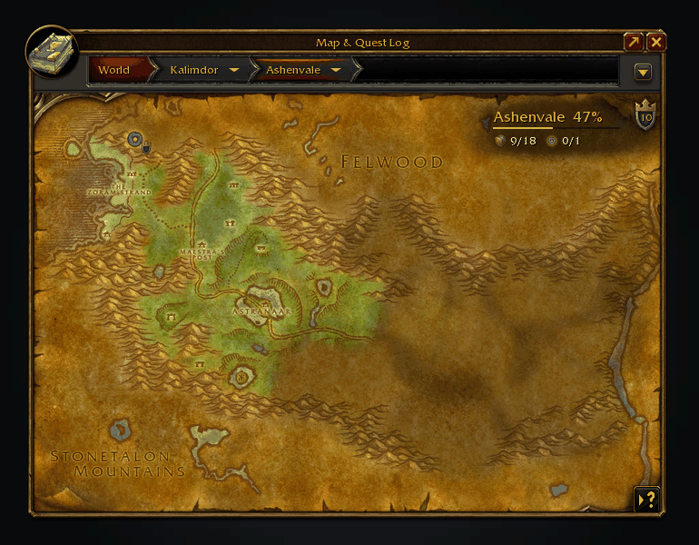
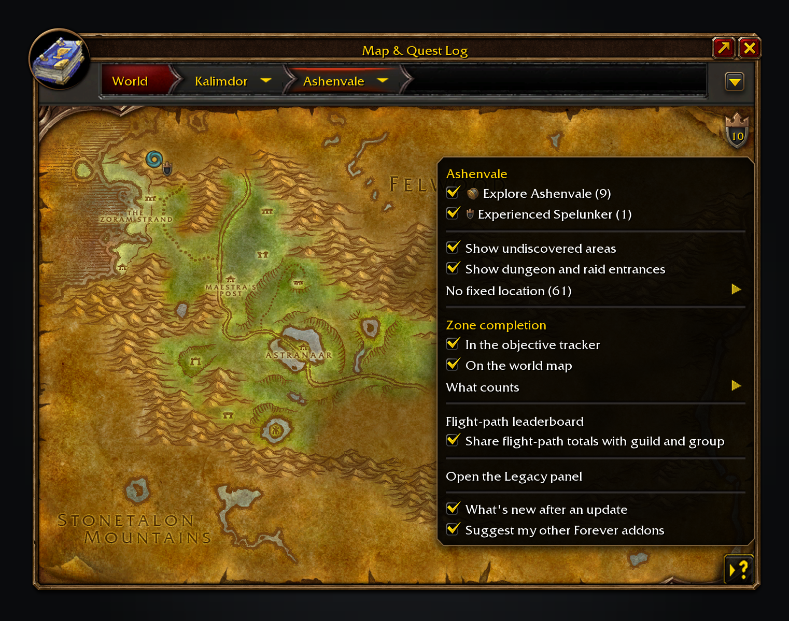
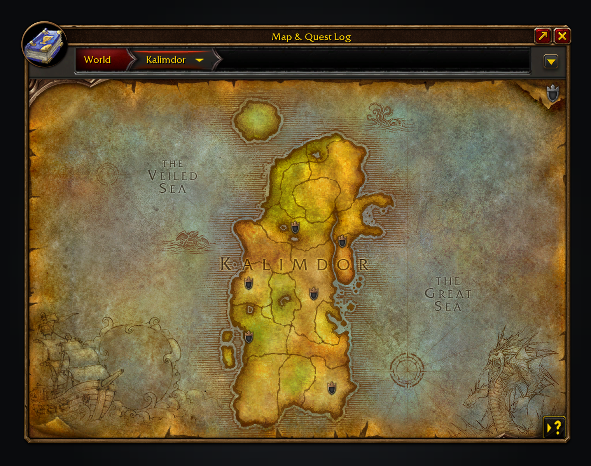
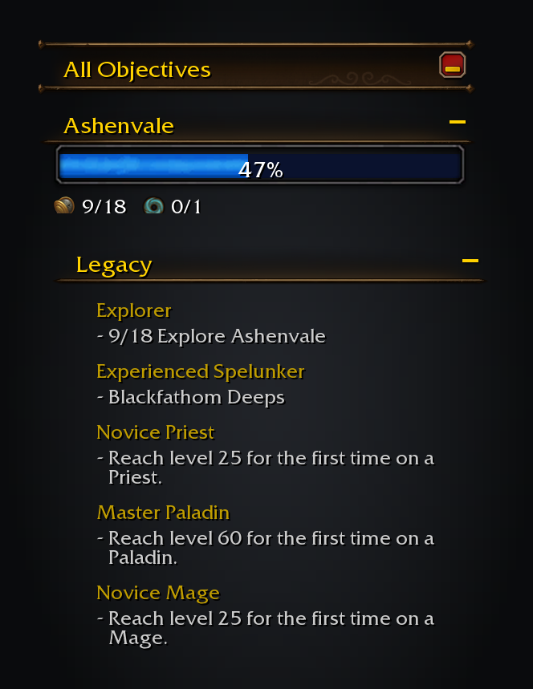
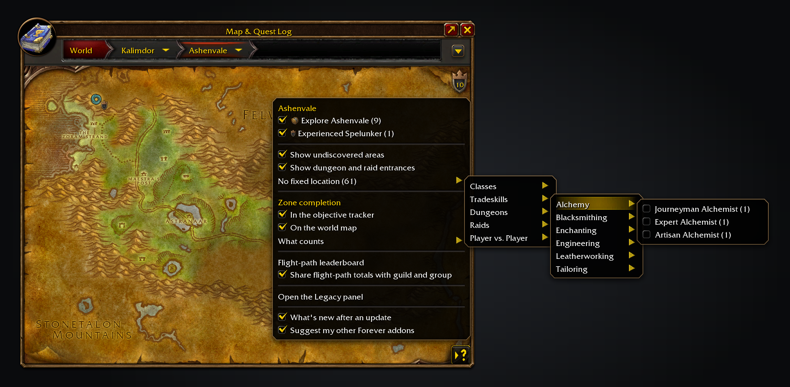

<p align="center"></p>

<h1 align="center">Legacy Forever</h1>

<p align="center">
Your unfinished WoW: Forever Legacy challenges, on the world map, for the zone you're looking at.<br>
<a href="https://github.com/cjber/legacy-forever/actions/workflows/ci.yml"></a>
<a href="https://github.com/cjber/legacy-forever/releases/latest"></a>
<a href="https://ko-fi.com/cjber"></a>
</p>

Legacy Forever shows unfinished challenges on the world map and tracks the ones you choose.

<p align="center"></p>

Discover an area and its shading lifts. The Legacy menu tracks the challenges behind it.

<p align="center"></p>

Half of Ashenvale explored: the shield's number is what's left on this map, and its menu lists it by challenge.

<p align="center"></p>

Zoom out and each zone with dungeon objectives left gets a badge.

<p align="center"></p>

Challenges you track sit in the objective tracker under the game's own header, with live progress.

<p align="center"></p>

Tick a challenge in the menu to track it.

## Features

- **Map button** in the world map's top-right button column: a Legacy shield with a number inside, the unfinished objectives on the map you're viewing. Its menu lists them by challenge, with a tick box to track each one. Challenges with no fixed place are grouped the way the Legacy panel groups them.
- **Tracker**: a Legacy section in the objective tracker, under the game's own All Objectives header, lists what you track, with live progress. A zone ticked in the map menu tracks just that zone, such as "0/12 Explore Felwood". Click a challenge to open it in the Legacy panel, or right-click to stop tracking it. [How it lists steps](docs/tracker.md).
- **Map pins** on dungeon and raid entrances, with the challenge each counts toward and its Legacy points. With AtlasLoot installed, tooltips also show its recommended level range. Left-click a pin to travel there: with [Shortest Path Forever](https://www.curseforge.com/wow/addons/shortest-path-forever) it plans the whole journey, otherwise it sets the game's own waypoint. If another addon already marks entrances, the map menu turns these pins off.
- **Undiscovered areas** are shaded darker in their real shape on the zone map, so you can see where to go at a glance. Hovering one names it and, when a Legacy challenge counts it, shows the challenge, its points and how many of the zone's areas are left. The map menu turns the shading off.
- **Zone completion**, Guild Wars 2 style: how much of a zone's areas, dungeons, raids and Legacy objectives you've done, as a badge on each zone of a continent map and, if you tick it, the tracker. The tracker's section fills the game's own progress bar with the percent inside it and counts each kind with the map's own icons. Flight paths, local reputations and, with Questie, quests can be added under "What counts". A finished zone gets a toast and a sound. [What it counts](docs/zone-completion.md).
- **No fixed location** lists challenges whose remaining work isn't tied to a place, such as levels, skills and ranks.

Progress comes from the game each time, so it matches the Legacy panel and follows whichever challenge set your character sees.

## Install

Install it from [CurseForge](https://www.curseforge.com/wow/addons/legacy-forever) or [Wago Addons](https://addons.wago.io/addons/legacy-forever), or download the zip from [Releases](https://github.com/cjber/legacy-forever/releases). To install the zip by hand, extract it into the WoW: Forever client's `Interface/AddOns/` folder (`_forever_` on the live client, `_classic_beta_` on the beta) so you end up with `AddOns/LegacyForever/LegacyForever.toc`.

## Usage

Open the world map, click the addon's icon in the addon compartment, or type `/lf`. The Legacy button sits below the map's own tracking buttons. Tick a challenge in its menu to add it to the tracker. Every option also lives under Options > AddOns > Legacy Forever, grouped into short pages behind an index. After an update, one chat line says which version you now have; "What's new after an update" turns it off.

| Command | What it does |
|---|---|
| `/lf` | Open the world map with the Legacy menu showing (`/lf help` lists these commands) |
| `/lf report` | Show a report to copy into a bug report: versions, the audit lines, recent errors |
| `/lf issue` | Open a ready-made GitHub issue link to report a bug or request a feature |
| `/lf audit` | Compare the bundled data with what the game reports, and list any objective the game doesn't know |
| `/lf criteria 684` | List every criterion the game reports for one achievement (useful alongside an audit's unknown IDs) |
| `/lf leaderboard` | Open Forever Leaderboards on the Legacy tab (also `/lf stats`) |
| `/lf share on\|off` | Turn sharing of flight-path totals with guild and group on or off |

Translated into French by Brainc3ll, and into German, Spanish, Korean, Brazilian Portuguese, Russian and Chinese by machine. French lines added since, such as the Forever addons page, are machine translated too. Corrections are welcome as a pull request or a [translation issue](https://github.com/cjber/legacy-forever/issues/new?template=translation.yml): [Locales](https://github.com/cjber/legacy-forever/tree/main/Locales) has the template.

## Where the locations come from

Everything is generated from the Forever client's own data (via [wago.tools](https://wago.tools)) by `tools/gen_legacy.py`. Objectives are joined by ID, not by name, and nothing is scraped from a database site; flight paths are the one exception, placed by the zone named in each node's name.

- **Areas:** each exploration criterion names a world map overlay. The zone map shades that overlay on the zone's current map art; exploration is never pinned.
- **Dungeons and raids:** placed at the client's entrance marker, only where the zone is certain.
- **Zone completion:** what each category counts, and where quests come from and why rares are left out, is in [docs/zone-completion.md](docs/zone-completion.md).
- **Kills, quests and reputations:** the client ships no spawn or encounter data for these, so they stay unpinned. The exception is Valthalak, a quest whose Blackrock Spire entrance was reviewed by hand. Track the challenge to follow their progress instead.

**Found a wrong or missing objective?** Type `/lf report` and paste what it shows into a [wrong objective issue](https://github.com/cjber/legacy-forever/issues/new?template=wrong_objective.yml).

Turn off **Attach to quest tracker** in Settings to drag the shared Forever column. Its position survives `/reload`; turn the setting back on to attach it above your quests.

Use `/lf leaderboard` to open Forever Leaderboards on the Legacy tab: distinct flight paths observed at flight masters, ranked against guild and group members on the same client ruleset. Peer totals are player-reported. Sharing is on unless you turn it off; `/lf share off`, the window's **Share my progress** box, or **Flight-path records** in Settings stops sends and peer comparisons while keeping your history. Totals already received by others can remain in their caches. The map menu offers the board and sharing switch too. Unknown client rulesets show only your personal row. Self-declared challenges such as Ironman are not automatically classified.

## Works alongside

All optional: [Shortest Path Forever](https://www.curseforge.com/wow/addons/shortest-path-forever) plans the journey when you click a map pin, and [Questie](https://www.curseforge.com/wow/addons/questie) supplies the quests zone completion can count (its [QuestieDB](https://github.com/Questie/QuestieDB/releases) addon on its own works too). A pin's tooltip carries a grey line suggesting Shortest Path Forever while you don't have it, and the zone completion tooltip one suggesting Adventure Guide Forever; "Suggest my other Forever addons", on the Forever addons page in the settings, turns them off. Other addons can read zone completion through `LegacyForever.API` ([docs/api.md](docs/api.md)); [Adventure Guide Forever](https://www.curseforge.com/wow/addons/adventure-guide-forever) does. The entrance icons and unexplored-area tint from [Tweaks Forever](https://www.curseforge.com/wow/addons/tweaks-forever) step aside where Legacy marks the map. Tracked challenges share one tracker column with the Shortest Path, Adventure Guide and SkillUp sections, above your quests.

<!-- forever-family:start -->

## The Forever addons

Each one works on its own, and they work together when you install more than one.

| Addon | What it does | Issues |
|---|---|---|
| [Shortest Path Forever](https://www.curseforge.com/wow/addons/shortest-path-forever) | Plans journeys on foot, by air, by sea and through portals, with directions in the tracker. | [Issues](https://github.com/cjber/shortest-path-forever/issues) |
| [Adventure Guide Forever](https://www.curseforge.com/wow/addons/adventure-guide-forever) | Suggests quests for your level and routes you from one to the next. | [Issues](https://github.com/cjber/adventure-guide-forever/issues) |
| [SkillUp Forever](https://www.curseforge.com/wow/addons/skillup-forever) | Shows skill-up chances, recipe costs and levelling routes in the Professions window. | [Issues](https://github.com/cjber/skillup-forever/issues) |
| [Legacy Forever](https://www.curseforge.com/wow/addons/legacy-forever) | Shows your unfinished Legacy challenges on the world map and tracks the ones you choose. | [Issues](https://github.com/cjber/legacy-forever/issues) |
| [Tweaks Forever](https://www.curseforge.com/wow/addons/tweaks-forever) | Adds quest automation, rare alerts and merchant options to the game's settings. | [Issues](https://github.com/cjber/tweaks-forever/issues) |

Bug reports, feature requests and pull requests are welcome on each addon's GitHub. Everyone whose report or idea ships is thanked by name in the addon's credits and changelog.

<!-- forever-family:end -->

With Shortest Path Forever, clicking a dungeon or raid pin plans the trip there. Adventure Guide Forever shows your
zone completion in its guide. Tweaks Forever's dungeon entrance icons and unexplored-area tint step aside where Legacy
already marks the map.

With Leatrix Maps revealing unexplored ground, Legacy leaves the map clear and keeps its exploration tooltips on hover.

Tracked challenges share one tracker column with the other addons' tracker sections, above your quests.

## Development

```sh
# link the checkout into the game
ln -s "$PWD" ".../World of Warcraft/_forever_/Interface/AddOns/LegacyForever"

luacheck .                     # lint
stylua --check .               # format
ruff format --check . && ruff check .
tools/typecheck.sh             # LuaLS 3.19.1 + multi-value lint and Python self-tests
for s in tests/*_spec.lua; do luajit "$s" || exit 1; done   # generated data, zone and challenge logic
python3 tools/gen_legacy.py    # regenerate Data/Legacy.lua (see tools/README.md)
```

Install LuaLS **3.19.1**, Python 3.12+ and Git before running `tools/typecheck.sh`. The first run
fetches the pinned WoW API annotations and their pinned FrameXML submodule into ignored `.types/`;
later runs verify and reuse that checkout. It checks every runtime Lua file, including generated
data, and fails on every diagnostic. `types/` supplies the addon and missing Forever API contracts.
See [the tooling notes](tools/README.md#type-checking) for the multi-value rule.

CI runs these checks on main pushes and pull requests. Each day a scheduled job checks wago.tools for a newer Forever build and, if the Legacy data differs, opens a pull request with the regenerated `Data/Legacy.lua`.

**Releasing:** move the `[Unreleased]` notes in `CHANGELOG.md` under `## [X.Y.Z] - YYYY-MM-DD`, then `git tag -s vX.Y.Z && git push --tags`, or run the Release workflow on main with `version` set. The [BigWigs packager](https://github.com/BigWigsMods/packager) builds the zip and uploads it to GitHub Releases, CurseForge and Wago, with that version's entry (`tools/changelog.py`) as the release notes.

**Contributing:** read [CONTRIBUTING.md](https://github.com/cjber/.github/blob/main/CONTRIBUTING.md) and this repository's [AGENTS.md](AGENTS.md). Report security problems privately, as [SECURITY.md](https://github.com/cjber/.github/blob/main/SECURITY.md) describes.

## Support

The addon is free and stays GPL-3.0. If it saves you time, you can [buy me a coffee on Ko-fi](https://ko-fi.com/cjber); nothing is locked behind it and there is no paid version.

## Credits

Brainc3ll translated Legacy Forever into French. Some features were inspired by [Polestar](https://github.com/fitzforge/polestar) by Fitz, such as `/lf report` and the issue forms; no code was copied. Fitz is welcome to use our code. Thanks to Bigabyte, overspark, deathmvp1, berserkerlxl and everyone who reported a bug or asked for a feature. [THIRD_PARTY.md](THIRD_PARTY.md) has the full list.

## Licence

GPL-3.0-or-later. Game data comes from the client via [wago.tools](https://wago.tools). Every input, its pin and licence, and what ships: [THIRD_PARTY.md](THIRD_PARTY.md).

Made by Cillian Berragan · [cillian.dev](https://cillian.dev) · [GitHub](https://github.com/cjber) · [Twitter](https://twitter.com/cjberragan)

Built with AI assistance.
