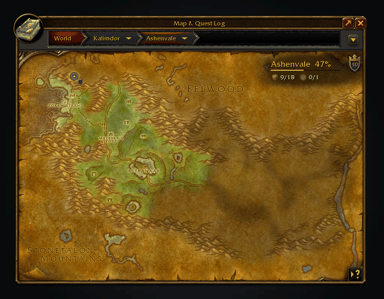
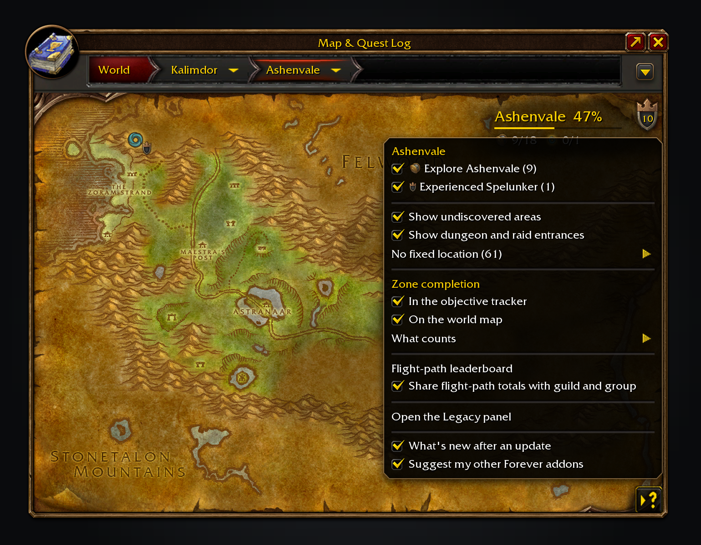
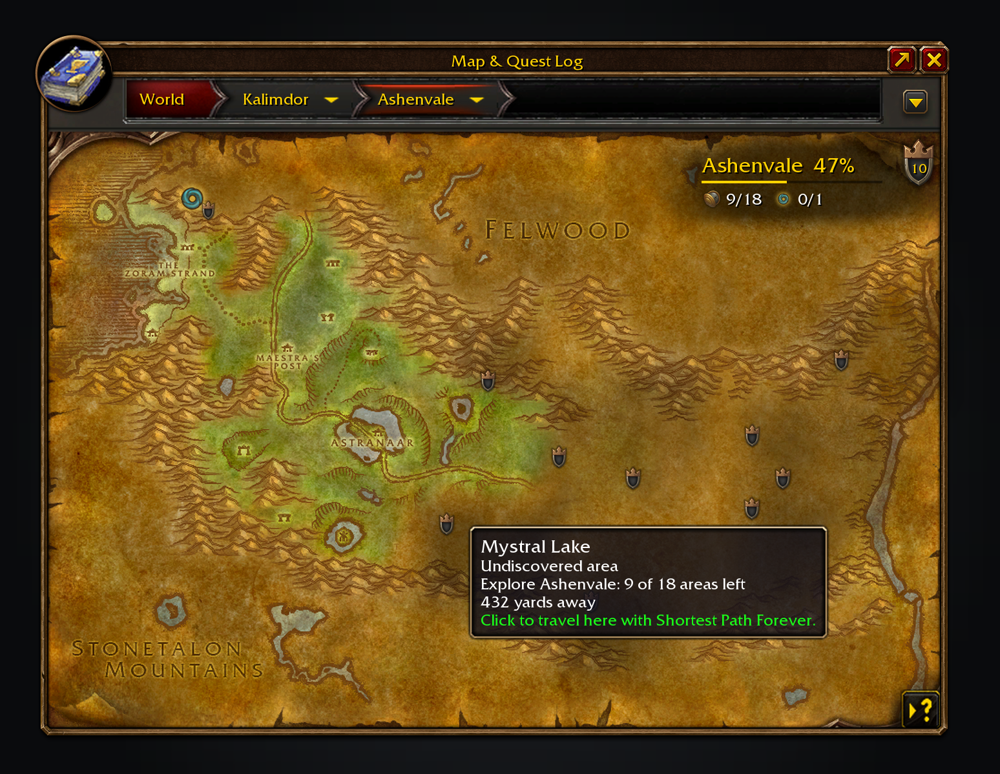
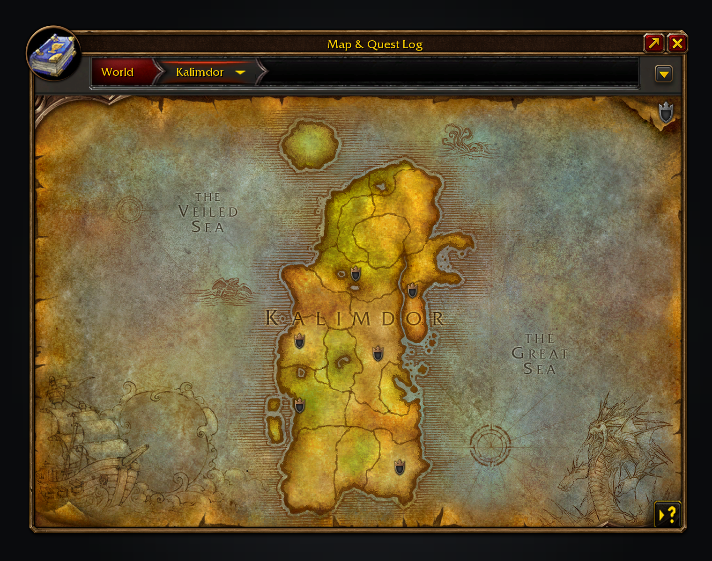
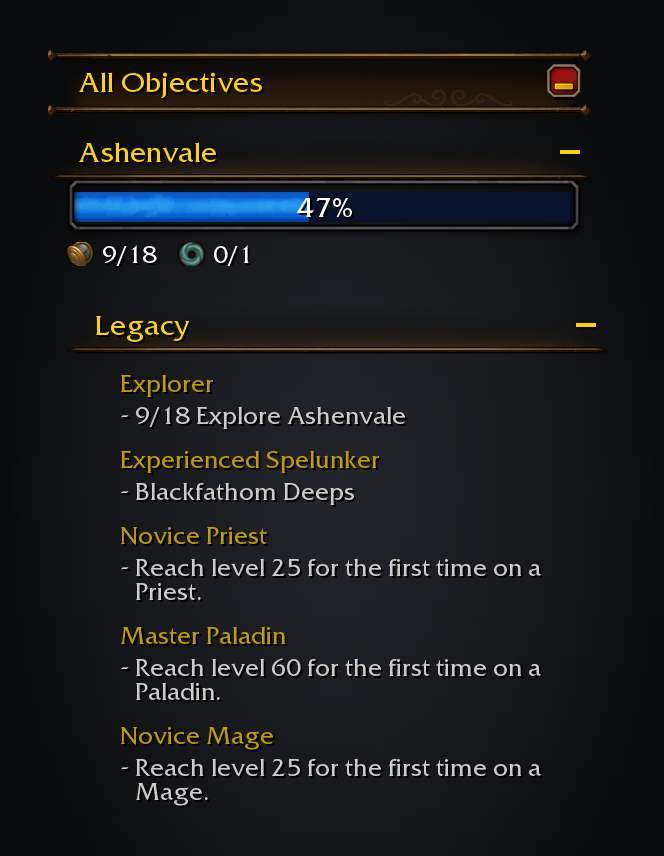
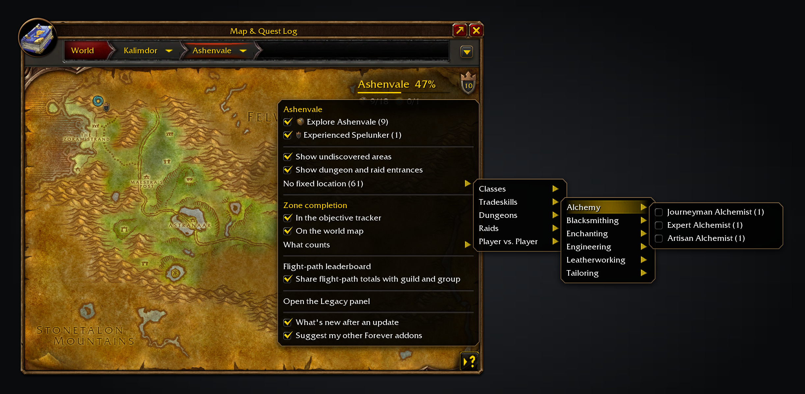

Legacy Forever shows unfinished Legacy challenges on the world map and tracks the ones you choose in the objective tracker.

Nothing else needs installing.

Free, with nothing locked behind it. If it saves you time, you can [sponsor me on GitHub](https://github.com/sponsors/cjber), which takes no fees, or [buy me a coffee on Ko-fi](https://ko-fi.com/cjber). For help and each day's release notes, [join me on Discord](https://discord.gg/FpHugGxRJY).

  

Discover an area and its shading lifts. The Legacy menu tracks the challenges behind it.

Half of Ashenvale explored: the shield's number is what's left on this map, and its menu lists it by challenge.

Off by default, "Show where to discover areas" glows each undiscovered area's real ground, with a shield at its nearest edge. Click one to travel there with Shortest Path Forever.

Zoom out and each zone with dungeon objectives left gets a badge.

Challenges you track sit in the objective tracker under the game's own header, with live progress.

Tick a challenge in the menu to track it.

These images are generated previews of the Legacy UI.

## Features

- **Map button.** A Legacy shield in the world map's button column, with the number of unfinished objectives on the map you're viewing inside it. Its menu lists them by challenge, with a tick box to track each one.
- **Tracker.** A Legacy section in the objective tracker lists what you track, with live progress, and a zone ticked in the map menu tracks just that zone, such as "0/12 Explore Felwood". Click a challenge to open it in the Legacy panel, or right-click to stop tracking it.
- **Map pins.** Dungeon and raid entrances show the challenge each counts toward and its Legacy points, plus the recommended level range in tooltips with AtlasLoot installed. Click one to travel there with Shortest Path Forever, or the game's own waypoint.
- **Undiscovered areas.** They are shaded in their real shape on the zone map, and hovering one shows which challenge counts it, its points and how many of the zone's areas are left. The map menu turns the shading off, or draws each area as a soft gold glow along its real ground with a pin at the nearest edge instead.
- **Zone completion.** Guild Wars 2 style, it shows how much of a zone's areas, dungeons, raids and Legacy objectives you've done: in whichever corner of the zone's map covers least of it, as a badge on each zone of a continent map and, if you tick it, in the tracker, where the game's own progress bar fills with the percent inside it and the map's own icons count each kind. Flight paths, local reputations and, with Questie, quests can be added under "What counts", and a finished zone gets a toast and a sound.
- **No fixed location.** Challenges whose remaining work isn't tied to a place, such as levels, skills and ranks, get a list of their own.

Progress comes from the game each time, so it always matches the Legacy panel. It only shows what the game already tracks; it doesn't add challenges or change how they count. Locations are generated from the Forever client's own data and joined by ID (flight paths by the zone in their name); nothing is scraped from a database site.

## Usage

Open the world map, or click the addon's icon in the addon compartment: the Legacy button sits below the map's own tracking buttons. Tick a challenge in its menu to track it. Every option also lives under Options > AddOns > Legacy Forever.

- `/lf` opens the world map with the Legacy menu showing; `/lf help` lists the commands.
- `/forever debug` keeps detailed log lines for this session; `pin` keeps them for the character, `off` turns them off, and `show` opens the report with them.
- `/lf issue` opens a ready-made GitHub issue link to report a bug or request a feature.
- `/lf audit` compares the bundled data with what the game reports.
- `/lf criteria 684` lists what the game reports for one achievement.

For a bug report, paste `/lf report`. The report includes errors and log lines from earlier sessions; for a wrong or missing objective, paste it into a [wrong objective issue](https://github.com/cjber/legacy-forever/issues/new?template=wrong_objective.yml).

Translated into French by Brainc3ll, and into German, Spanish, Korean, Brazilian Portuguese, Russian and Chinese by machine; French lines added since, such as the Forever addons page, are machine translated too. Corrections are welcome as a pull request or through the [translation form](https://github.com/cjber/legacy-forever/issues/new?template=translation.yml), and [Locales](https://github.com/cjber/legacy-forever/tree/main/Locales) has the template.

<!-- forever-family:start -->

## The Forever addons

Each one works on its own, and they work together when you install more than one.

| Addon | What it does | Issues |
|---|---|---|
| [Shortest Path Forever](https://www.curseforge.com/wow/addons/shortest-path-forever) | Plans journeys on foot, by air, by sea and through portals, with directions in the tracker. | [Issues](https://github.com/cjber/shortest-path-forever/issues) |
| [Adventure Guide Forever](https://www.curseforge.com/wow/addons/adventure-guide-forever) | Suggests quests for your level and routes you from one to the next. | [Issues](https://github.com/cjber/adventure-guide-forever/issues) |
| [SkillUp Forever](https://www.curseforge.com/wow/addons/skillup-forever) | Shows skill-up chances, recipe costs and levelling routes in the Professions window. | [Issues](https://github.com/cjber/skillup-forever/issues) |
| [Legacy Forever](https://www.curseforge.com/wow/addons/legacy-forever) | Shows your unfinished Legacy challenges on the world map and tracks the ones you choose. | [Issues](https://github.com/cjber/legacy-forever/issues) |
| [Tweaks Forever](https://www.curseforge.com/wow/addons/tweaks-forever) | Adds quest automation, rare alerts and merchant options to the game's settings. | [Issues](https://github.com/cjber/tweaks-forever/issues) |
| [Field Guide Forever](https://www.curseforge.com/wow/addons/field-guide-forever) | Keeps a cosmetic journal of the creatures you kill, zone by zone. | [Issues](https://github.com/cjber/field-guide-forever/issues) |
| [Commissions Forever](https://www.curseforge.com/wow/addons/commissions-forever) | Lists your commission turn-ins, the materials in your bags and the next NPC to visit. | [Issues](https://github.com/cjber/commissions-forever/issues) |
| [Macro Assist Forever](https://www.curseforge.com/wow/addons/macro-assist-forever) | Adds a macro window with every macro in one list, a mono editor with live checks, and history. | [Issues](https://github.com/cjber/macro-assist-forever/issues) |

Bug reports, feature requests and pull requests are welcome on each addon's GitHub. Everyone whose report or idea ships is thanked by name on the Thanks page in game, in the store page and in the changelog, unless they ask not to be.

For help, ideas and each day's release notes, join [cjber's Workshop on Discord](https://discord.gg/FpHugGxRJY).

<!-- forever-family:end -->

With Shortest Path Forever, clicking a dungeon or raid pin plans the trip there. Adventure Guide Forever shows your zone completion in its guide. Tweaks Forever's dungeon entrance icons and unexplored-area tint step aside where Legacy already marks the map. Tracked challenges share one tracker column with the other addons' tracker sections, above your quests.

<!-- forever-credits:start -->

Thanks to overspark, Lûca, cotijelucie, Brainc3ll, Bigabyte, Mouchoir, DanielVafidis, TheCheat54, KeijinDE and everyone who reported a bug or asked for a feature.

<!-- forever-credits:end -->

Source code and issues: [github.com/cjber/legacy-forever](https://github.com/cjber/legacy-forever). Licence: GPL-3.0-or-later.

Built with AI assistance.
